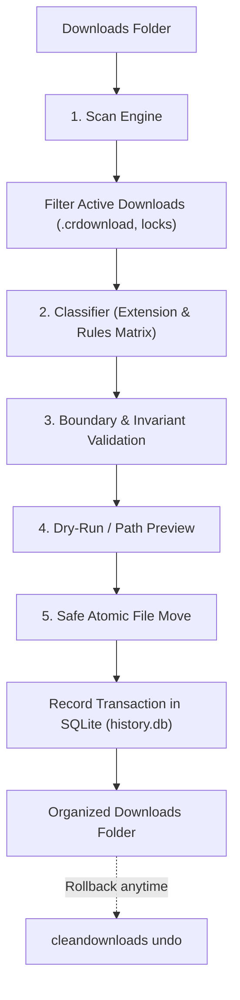

<div align="center">


# CleanDownloads

### *One command. Zero clutter.*

**A smart, safe, and automated Downloads folder organizer for Microsoft Windows.**

[](CHANGELOG.md)
[](docs/DISTRIBUTION_READINESS.md)
[](https://www.python.org/)
[](LICENSE)
[](SECURITY.md)
[](docs/WINGET_GUIDE.md)
[](tests/)

</div>

---

<p align="center">
  
</p>

## ⚡ The Hero Experience

Your Downloads folder shouldn't be a messy graveyard of mixed PDFs, half-installed tools, and forgotten archives. 

**CleanDownloads** automatically organizes your files into clean, predictable categories — **safely, locally, and effortlessly.**

Open PowerShell (no administrator privileges needed) and paste:

```powershell
irm https://raw.githubusercontent.com/mohdyasir5155/CleanDownloads/main/install.ps1 | iex
```

That's it. CleanDownloads is instantly installed to your user profile and ready to organize your Downloads folder in seconds.

---

## 📸 Real Application in Action

<table align="center" width="100%">
<tr>
<th width="50%">📂 Folder Organization Flow</th>
<th width="50%">💻 Interactive Terminal Dashboard</th>
</tr>
<tr>
<td align="center">
  
</td>
<td align="center">
  
</td>
</tr>
</table>

<p align="center">
  
</p>

---

## ✨ Features

- **🎯 Smart File Classification**: Out-of-the-box recognition for 13+ standard categories and hundreds of file extensions (PDF, Word, Excel, PowerPoint, Images, Videos, Audio, Archives, Installers, Code, and more).
- **🛡 14 Strict Safety Invariants**:
  - **Zero data loss**: CleanDownloads **never deletes** your files.
  - **Zero overwrites**: If a file with the same name exists at destination, CleanDownloads automatically appends a numbered suffix (e.g. `invoice (1).pdf`).
  - **Execution prevention**: CleanDownloads moves files; it never executes or invokes untrusted downloaded programs.
  - **In-flight download detection**: Automatically detects active browser downloads (`.crdownload`, `.part`, `.tmp`) and active file locks to prevent moving incomplete files.
  - **Directory traversal containment**: Mathematical boundary checking prevents directory traversal attacks and symlink escapes outside your Downloads folder.
  - **Root-only default**: Only organizes files sitting at the root of Downloads; your existing subfolders are never touched unless you explicitly run with recursive flags.
- **🔍 Preview & Dry-Run Mode**: See exactly where every single file will be placed before anything is touched with `cleandownloads organize --dry-run`.
- **↩ 1-Click Reliable Undo**: Full operation history stored in a local SQLite database (`%LOCALAPPDATA%\CleanDownloads\history.db`). Reverse your last organization batch anytime with `cleandownloads undo`.
- **⏰ Background Automation**: Optional Windows Task Scheduler integration for automatic background organizing (every 30 mins, 1 hour, daily, or on logon). Disabled by default.
- **🔒 100% Private & Local**: Zero telemetry. No filenames, hashes, or contents ever leave your computer.
- **💻 Dual Interface**: Choose between an interactive terminal manager and fast, scriptable CLI subcommands.

---

## 📦 Installation Methods

### 1. PowerShell Bootstrapper (Recommended)

Fast, secure, and requires no administrator rights:

```powershell
irm https://raw.githubusercontent.com/mohdyasir5155/CleanDownloads/main/install.ps1 | iex
```

*What this does:* Downloads release assets over HTTPS, verifies the SHA-256 checksum and Authenticode digital signature, installs to `%LOCALAPPDATA%\Programs\CleanDownloads`, and registers the binary on your user `PATH`.

---

### 2. Windows Setup Wizard (Inno Setup)

1. Download `CleanDownloads-Setup-1.0.0.exe` from [GitHub Releases](https://github.com/mohdyasir5155/CleanDownloads/releases/latest).
2. (Optional) Verify checksum:
   ```powershell
   Get-FileHash .\CleanDownloads-Setup-1.0.0.exe -Algorithm SHA256
   ```
3. Run the installer. It supports both graphical wizard and headless silent installation:
   ```powershell
   .\CleanDownloads-Setup-1.0.0.exe /VERYSILENT /SUPPRESSMSGBOXES /NORESTART
   ```

---

### 3. Microsoft WinGet Community Package

> [!NOTE]
> **Community Review Status:** The package manifests are prepared and validated under `CleanDownloads.CleanDownloads`. WinGet installation will become available once the pull request to [microsoft/winget-pkgs](https://github.com/microsoft/winget-pkgs) is approved and merged. See [`docs/WINGET_GUIDE.md`](docs/WINGET_GUIDE.md).

```powershell
# Once approved by Microsoft moderators:
winget install CleanDownloads.CleanDownloads
```

---

### 4. Portable Standalone Executable

Prefer zero installation? Download `cleandownloads.exe` directly:
- **No Python required.**
- Single self-contained Windows x64 binary.
- Place it anywhere in your user `PATH`.

---

## 🚀 Quick Start & CLI Reference

Launch the interactive dashboard by running:

```powershell
cleandownloads
```

Or execute commands directly:

```powershell
# 1. Scan Downloads and view categorized file breakdown
cleandownloads scan

# 2. Preview proposed file movements without touching any files
cleandownloads organize --dry-run

# 3. Organize Downloads into categorized folders
cleandownloads organize

# 4. Undo the last organization operation
cleandownloads undo

# 5. Undo a specific batch from history
cleandownloads undo --batch-id 20261101-01

# 6. View recent organization history logs
cleandownloads history

# 7. Check environment, paths, and scheduler status
cleandownloads status

# 8. Enable automated background scheduler (hourly, daily, or at logon)
cleandownloads schedule --enable hourly

# 9. Disable background scheduler
cleandownloads schedule --disable

# 10. Reset classification rules to default
cleandownloads config --reset
```

---

## 🔄 How It Works

CleanDownloads operates as a deterministic, multi-stage state machine:



1. **Scan:** Reads root of Downloads, skipping system files and active browser downloads (`.crdownload`, `.part`, `.tmp`).
2. **Classify:** Maps file extensions against configurable rules in `%LOCALAPPDATA%\CleanDownloads\config.json`.
3. **Safety Gate:** Confirms destination is strictly inside Downloads, prevents directory traversal, and calculates collision-free target paths (`file (1).pdf`).
4. **Organize:** Performs atomic file movements.
5. **Ledger:** Writes batch operations to `%LOCALAPPDATA%\CleanDownloads\history.db` for reversible 1-click undo.

---

## 📁 Folder Organization Example

```text
Before CleanDownloads:                   After CleanDownloads:
Downloads/                              Downloads/
├── quarterly_report.pdf                 ├── Documents/
├── landscape.png                        │   ├── PDF/quarterly_report.pdf
├── vscode_installer.exe                 │   └── Word/meeting_notes.docx
├── backup_2026.zip                      ├── Images/
├── tutorial.mp4                         │   └── PNG/landscape.png
├── meeting_notes.docx                   ├── Software/
├── podcast_episode.mp3                  │   └── EXE/vscode_installer.exe
└── parse_data.py                        ├── Archives/
                                         │   └── ZIP/backup_2026.zip
                                         ├── Videos/tutorial.mp4
                                         ├── Audio/podcast_episode.mp3
                                         └── Code/
                                             └── Python/parse_data.py
```

---

## ⚙ Configuration & Custom Rules

CleanDownloads comes pre-configured with rules for common file formats, but you can easily customize categories and extensions.

Configuration is stored at:  
`%LOCALAPPDATA%\CleanDownloads\config.json`

### Example Custom Rule Configuration

```json
{
  "rules": {
    "Documents": {
      "subfolders": {
        "PDF": [".pdf"],
        "Word": [".doc", ".docx", ".odt", ".rtf"],
        "Spreadsheets": [".xls", ".xlsx", ".csv", ".tsv"],
        "Presentations": [".ppt", ".pptx"]
      }
    },
    "Data Science": {
      "subfolders": {
        "Datasets": [".parquet", ".arrow", ".jsonl"],
        "Notebooks": [".ipynb"]
      }
    },
    "Creative": {
      "subfolders": {
        "Design": [".psd", ".ai", ".fig", ".sketch"],
        "3D Models": [".obj", ".fbx", ".blend", ".stl"]
      }
    }
  }
}
```

To restore factory default classification rules at any time, run:

```powershell
cleandownloads config --reset
```

---

## 🛡 Safety Invariants & Privacy

CleanDownloads is engineered with a strict **Safety-First** mindset:

| Invariant | Guarantee |
| :--- | :--- |
| **No Deletion** | The application does not contain deletion routines for your personal files. CleanDownloads only organizes. |
| **No Overwriting** | Moving a file will never replace or overwrite an existing file with the same name. Suffixes like `(1)`, `(2)` are automatically generated. |
| **Boundary Containment** | Symlinks, junction points, and relative paths (`..`) escaping the root Downloads folder are mathematically rejected. |
| **Active Lock Protection** | In-flight browser downloads and files currently held open by other Windows applications are detected and skipped. |
| **Root-Only Isolation** | Only top-level files in your Downloads directory are sorted. Subfolders you manually organized are left undisturbed. |
| **100% Local & Private** | Zero analytics, zero telemetry, and zero network calls during scanning and organizing. |

*Note: While CleanDownloads guarantees strict non-destruction and collision safety, files moved externally after an organization run cannot be restored by the undo command.*

---

## 🔄 Upgrading

Upgrading preserves all your custom rules and activity history database:

- **Via PowerShell:**
  ```powershell
  irm https://raw.githubusercontent.com/mohdyasir5155/CleanDownloads/main/install.ps1 | iex
  ```
- **Via Inno Setup:**
  Download and run the new `CleanDownloads-Setup-<version>.exe`.
- **Via WinGet (when approved):**
  ```powershell
  winget upgrade CleanDownloads.CleanDownloads
  ```

---

## 🗑 Uninstallation

CleanDownloads uninstalls cleanly without leaving orphaned registry entries or touching your Downloads folder:

1. **Windows Settings:** Open **Installed apps** > Select **CleanDownloads** > Click **Uninstall**.
2. **Via Uninstaller Binary:**
   ```powershell
   & "$env:LOCALAPPDATA\Programs\CleanDownloads\unins000.exe" /VERYSILENT
   ```
3. **Via Script:**
   ```powershell
   powershell -ExecutionPolicy Bypass -File uninstall.ps1
   ```

---

## 🖥 System Requirements

- **Operating System:** Microsoft Windows 10 (Build 19045+) or Windows 11 (x64)
- **Privileges:** Standard User (Administrator rights are **not** required)
- **Dependencies:** None. The standalone binary bundles all required runtimes.

---

## 🤝 Contributing

Contributions are warmly welcomed! Please read our [Contributing Guidelines](CONTRIBUTING.md) and [Code of Conduct](CODE_OF_CONDUCT.md).

```powershell
# 1. Clone repository
git clone https://github.com/mohdyasir5155/CleanDownloads.git
cd CleanDownloads

# 2. Setup environment
python -m venv .venv
.\.venv\Scripts\Activate.ps1
pip install -e ".[dev]"

# 3. Run automated tests
pytest tests/ -v
ruff check src/ tests/
```

---

## 🗺 Roadmap

- [x] Python core classification engine with 13+ standard categories
- [x] SQLite-backed reversible transaction ledger and 1-click undo
- [x] Windows Task Scheduler automation integration
- [x] PyInstaller standalone single-file binary with zero dependencies
- [x] Inno Setup Windows installer with user PATH integration
- [x] Microsoft WinGet Community Package manifests
- [x] Automated GitHub Actions CI/CD release pipeline
- [ ] Windows File Explorer Right-Click Context Menu ("Organize with CleanDownloads")
- [ ] Windows System Tray background daemon
- [ ] Visual GUI Rule Customizer

---

## 📄 License & Credits

CleanDownloads is open-source software licensed under the [MIT License](LICENSE).

Developed and maintained with ❤️ by [mohdyasir5155](https://github.com/mohdyasir5155).
