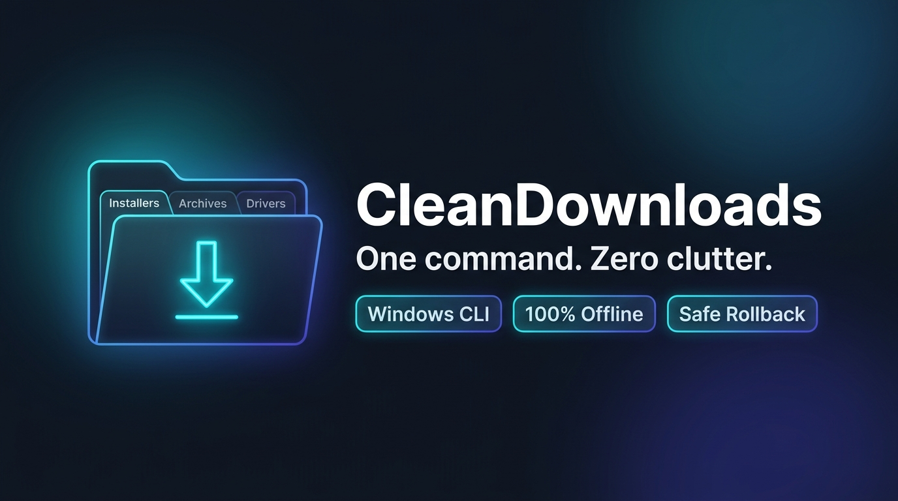
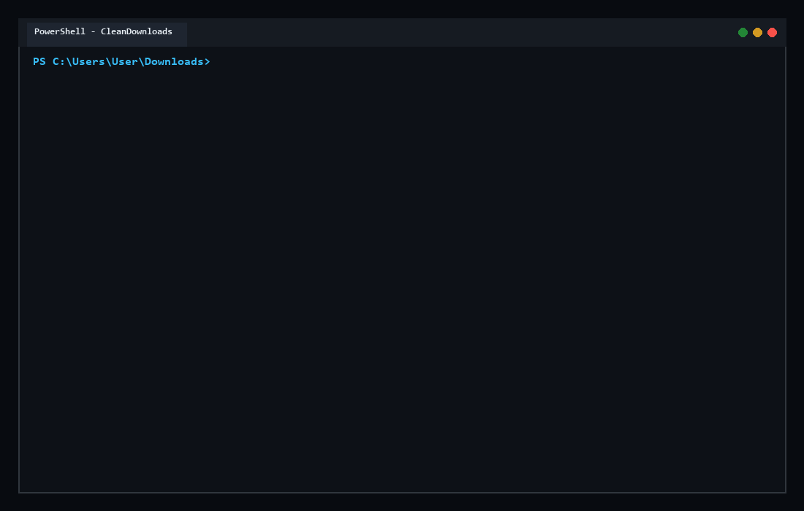
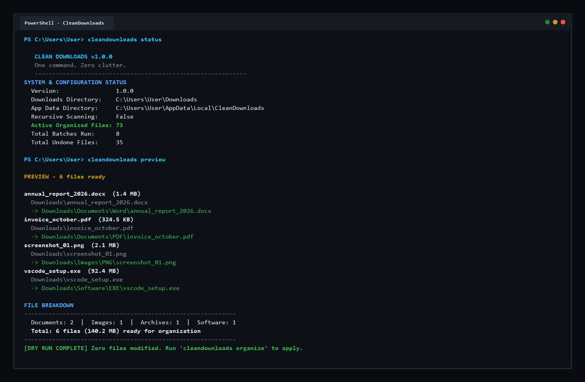
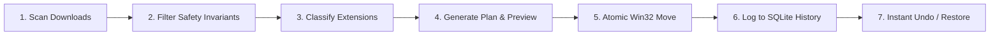
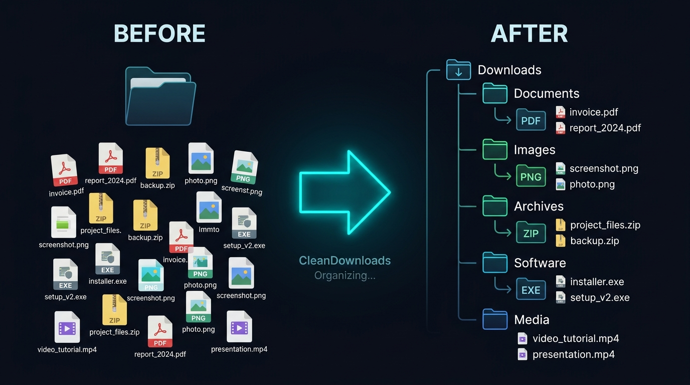

<div align="center">


# CleanDownloads

### *One command. Zero clutter.*

**Smart, safe, and lightning-fast Downloads folder organizer for Windows.**

[](https://github.com/mohdyasir5155/CleanDownloads/releases/tag/v1.0.0)
[-0078D6.svg?style=flat-square&logo=windows&logoColor=white)](https://github.com/mohdyasir5155/CleanDownloads)
[](https://www.python.org/)
[](LICENSE)
[](tests/)
[](SECURITY.md)
[](SECURITY.md)

<p align="center">
  <a href="#-quick-installation">Installation</a> •
  <a href="#-quick-start">Quick Start</a> •
  <a href="#-core-features">Features</a> •
  <a href="#-how-it-works">How It Works</a> •
  <a href="#-safety--privacy">Safety & Privacy</a> •
  <a href="#-configuration">Configuration</a> •
  <a href="#-contributing">Contributing</a> •
  <a href="#-license">License</a>
</p>

</div>

---

<p align="center">
  
</p>

## 💡 Why CleanDownloads?

> *Your Downloads folder shouldn't be a mess. CleanDownloads automatically organizes your files into meaningful categories — safely, locally, and effortlessly.*

Over weeks and months, your Windows `Downloads` folder becomes a digital graveyard of invoices, screenshots, installers, zip archives, and scripts. Manual cleanup takes time, while hasty deletions risk losing critical files. 

**CleanDownloads** transforms chaos into order in a fraction of a second. It inspects your loose downloads, categorizes them according to clean file rules, previews every planned change, and safely relocates files with kernel-level overwrite protection and instant rollback support.

<p align="center">
  
</p>

### ⚡ 5-Second Installation Shortcut

Open **PowerShell** (no Administrator privileges required) and paste:

```powershell
irm https://raw.githubusercontent.com/mohdyasir5155/CleanDownloads/main/install.ps1 | iex
```

---

## ✨ Core Features

Every feature in CleanDownloads is engineered around **safety, speed, and privacy**:

- **🎯 Automatic File Categorization**: Out-of-the-box recognition for 13+ standard categories and hundreds of file extensions (PDF, Word, Excel, PowerPoint, Images, Videos, Audio, Archives, Software, Code, Spreadsheets, Presentations, E-Books, and Fonts).
- **🛡 Safe File Movement (Zero Overwrite Guarantee)**: Files are never silently overwritten. Colliding filenames are resolved automatically using incremental numbers (e.g., `invoice (1).pdf`) backed by kernel-level Win32 `MoveFileExW` guarantees.
- **🔍 Preview & Dry-Run Mode**: Inspect exactly which files will move and where they will go with `cleandownloads preview` or `cleandownloads organize --dry-run` before any file is touched.
- **↩ 1-Click Cryptographic Undo**: Every file movement is logged to a local SQLite database (`%LOCALAPPDATA%\CleanDownloads\history.db`) along with its streaming SHA-256 hash. Undo your last operation anytime with `cleandownloads undo`.
- **⏳ Active Download & Lock Protection**: CleanDownloads detects incomplete downloads (`.crdownload`, `.part`, `.tmp`, `.opdownload`, `.aria2`) and files locked by running applications, skipping them safely until transfers complete.
- **⏰ Automated Background Organization**: Optional Windows Task Scheduler integration (`cleandownloads schedule --enable hourly`) to maintain an immaculate folder hands-free.
- **⚙ Fully Customizable Rules**: Configure custom categories, subfolders, ignored extensions, and size limits via a straightforward JSON configuration file.
- **🔒 100% Local & Private**: Operates entirely offline with zero network requests and zero telemetry. Your filenames, paths, and document contents never leave your machine.
- **⚡ Zero External Runtime Dependencies**: Available as a single standalone executable (`cleandownloads.exe`) requiring no Python installation.

---

## 📦 Verified Installation Methods

Choose the installation method that fits your environment:

### Option 1: PowerShell Bootstrapper (Recommended)

Installs the verified release to your user profile (`%LOCALAPPDATA%\Programs\CleanDownloads`) and adds it to your user `PATH`:

```powershell
irm https://raw.githubusercontent.com/mohdyasir5155/CleanDownloads/main/install.ps1 | iex
```

### Option 2: Windows Setup Installer (GitHub Releases)

1. Download **`CleanDownloads-Setup-1.0.0.exe`** and **`checksums.txt`** from the [Latest Release](https://github.com/mohdyasir5155/CleanDownloads/releases/latest).
2. *(Optional)* Verify the SHA-256 checksum:
   ```powershell
   Get-FileHash CleanDownloads-Setup-1.0.0.exe -Algorithm SHA256
   ```
3. Run the installer interactively or silently:
   ```powershell
   .\CleanDownloads-Setup-1.0.0.exe /VERYSILENT /SUPPRESSMSGBOXES /NORESTART
   ```

### Option 3: Standalone Portable Executable

If you prefer a single binary without an installer:
1. Download **`cleandownloads.exe`** from [GitHub Releases](https://github.com/mohdyasir5155/CleanDownloads/releases/latest).
2. Place `cleandownloads.exe` anywhere on your `PATH` (e.g. `C:\Tools` or `C:\Users\<User>\bin`).
3. Run `cleandownloads` from any terminal.

### Option 4: Microsoft WinGet (Community Package)

> [!NOTE]
> **Status: Package Manifest Prepared.** The manifest `CleanDownloads.CleanDownloads` has been prepared in accordance with Microsoft Community Package standards. WinGet installation will become active following review and merge into [microsoft/winget-pkgs](https://github.com/microsoft/winget-pkgs).

```powershell
winget install CleanDownloads.CleanDownloads
```

---

## 🚀 Quick Start

Launch the interactive terminal manager by typing `cleandownloads`, or run specific subcommands directly:

```powershell
# 1. Check system configuration and history stats
cleandownloads status

# 2. Scan Downloads folder and view file breakdown
cleandownloads scan

# 3. Preview planned file moves without touching any files
cleandownloads preview

# 4. Simulate complete organization run (dry run)
cleandownloads organize --dry-run

# 5. Execute file organization
cleandownloads organize

# 6. View recent organization operations log
cleandownloads history

# 7. Reverse the most recent organization batch
cleandownloads undo

# 8. Enable automated background scheduler (runs hourly)
cleandownloads schedule --enable hourly

# 9. View or reset configuration
cleandownloads config
```

<p align="center">
  
</p>

---

## 🔄 How It Works

CleanDownloads operates as a linear, deterministic state machine:



1. **Scan**: Enumerate files in the root of your `Downloads` directory (subdirectories are protected and left untouched by default).
2. **Filter**: Check safety invariants—skip hidden/system files, active browser downloads, locked files, and junction symlinks.
3. **Classify**: Match compound and single file extensions against defined rules (e.g., `.tar.gz`, `.pdf`, `.docx`).
4. **Plan & Preview**: Check destination paths for name collisions; generate sequence numbers `(1)` if a duplicate name exists.
5. **Organize**: Execute atomic file moves via Win32 `MoveFileExW` without overwrite flags.
6. **Record**: Store before/after paths, timestamps, and SHA-256 hashes in `%LOCALAPPDATA%\CleanDownloads\history.db`.
7. **Rollback**: On `undo`, verify destination file hash and restore the file to its original root location.

---

## 📁 Folder Organization Example

<p align="center">
  
</p>

<table align="center" width="100%">
<tr>
<th width="50%">❌ Before (Cluttered Downloads)</th>
<th width="50%">✔ After CleanDownloads</th>
</tr>
<tr>
<td>

```text
Downloads/
├── annual_report_2026.docx
├── invoice_october.pdf
├── screenshot_01.png
├── project_backup.zip
├── vscode_setup.exe
├── video_tutorial.mp4
├── podcast_episode.mp3
├── automation_script.py
├── financial_model.xlsx
└── book_reference.epub
```

</td>
<td>

```text
Downloads/
├── Documents/
│   ├── PDF/invoice_october.pdf
│   └── Word/annual_report_2026.docx
├── Images/
│   └── PNG/screenshot_01.png
├── Archives/
│   └── ZIP/project_backup.zip
├── Software/
│   └── EXE/vscode_setup.exe
├── Media/
│   ├── video_tutorial.mp4
│   └── podcast_episode.mp3
├── Code/
│   └── Python/automation_script.py
├── Spreadsheets/
│   └── financial_model.xlsx
└── E-Books/
    └── book_reference.epub
```

</td>
</tr>
</table>

---

## ⚙ Configuration & Customization

CleanDownloads stores its configuration at:

```
%LOCALAPPDATA%\CleanDownloads\config.json
```

### Viewing and Modifying Settings

```powershell
# Print current JSON configuration
cleandownloads config --json

# Open interactive configuration manager
cleandownloads config

# Reset configuration to factory defaults
cleandownloads config --reset
```

### Configuration Options

| Option | Type | Default | Description |
| :--- | :--- | :--- | :--- |
| `downloads_dir` | string | `null` | Target directory (defaults to user's Windows Downloads path) |
| `recursive` | boolean | `false` | Scan subdirectories (`false` keeps nested folders untouched) |
| `conflict_strategy` | string | `"rename"` | Conflict strategy: automatically adds `(1)`, `(2)` suffix |
| `ignored_extensions` | list | `[ "crdownload", "part", "tmp", ... ]` | In-progress extensions to skip unconditionally |
| `excluded_directories`| list | `[ "Documents", "Images", ... ]` | Category directories ignored during root scan |
| `default_fallback_folder`| string | `"Other"` | Destination folder for unrecognized extensions |

---

## 🛡 Safety, Security, and Privacy

CleanDownloads is built on defensive principles:

- **Zero Deletion Guarantee**: CleanDownloads contains no deletion logic for user files. There is no `unlink`, `remove`, or purge command.
- **Kernel-Level Overwrite Prevention**: Uses native Win32 `MoveFileExW` without `MOVEFILE_REPLACE_EXISTING`. Collisions are renamed atomically.
- **Path Traversal & Boundary Containment**: Enforces strict canonical path boundary checks. Relative paths (`..`), directory escapes, and Windows reserved device names (`CON`, `PRN`, `AUX`, `NUL`) are rejected immediately.
- **In-Progress Download Protection**: Detects and leaves active browser downloads untouched.
- **Cryptographic Hash Verification**: File movements record pre-move SHA-256 hashes. Restoring via `undo` verifies the file has not been modified or corrupted.
- **100% Offline Privacy**: CleanDownloads never makes network connections during operation. Zero analytics, zero telemetries, and zero file metadata transmissions.
- **Known Limitations**: Files actively locked with exclusive OS access cannot be moved until the locking application is closed; CleanDownloads will report these safely and leave them in place.

For complete architectural threat models and security guarantees, see [SECURITY.md](SECURITY.md) and [docs/SECURITY_ARCHITECTURE.md](docs/SECURITY_ARCHITECTURE.md).

---

## 🛠 Contributing

We welcome community contributions, bug reports, and new classification rules!

1. **Fork the repository** on GitHub.
2. **Clone your fork**:
   ```powershell
   git clone https://github.com/mohdyasir5155/CleanDownloads.git
   cd CleanDownloads
   ```
3. **Set up virtual environment**:
   ```powershell
   python -m venv .venv
   .\.venv\Scripts\Activate.ps1
   pip install -e ".[dev]"
   ```
4. **Run the test suite**:
   ```powershell
   pytest -v
   ruff check .
   bandit -r src/ -ll
   ```
5. **Create a feature branch** and submit a Pull Request.

Please review our [CONTRIBUTING.md](CONTRIBUTING.md) and [CODE_OF_CONDUCT.md](CODE_OF_CONDUCT.md) before submitting.

---

## 🗺 Realistic Roadmap

- [x] v1.0.0: Core classification engine (13+ categories).
- [x] v1.0.0: Win32 collision-safe move & zero overwrite.
- [x] v1.0.0: SQLite history logging & cryptographic rollback (`undo`).
- [x] v1.0.0: Windows Task Scheduler integration (`schedule`).
- [x] v1.0.0: Inno Setup Windows installer & PowerShell bootstrapper.
- [ ] v1.1.0: File-age filtering rules (e.g., only organize files older than 3 days).
- [ ] v1.2.0: Desktop GUI tray app (Tauri + React preview).
- [ ] v1.3.0: Custom regex-based tag and project rules.

---

## 📄 License & Credits

CleanDownloads is released under the **[MIT License](LICENSE)**.

Developed and maintained with ❤️ by [mohdyasir5155](https://github.com/mohdyasir5155) and open-source contributors.
